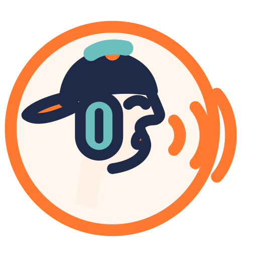

<p align="center">
  <picture>
    <source media="(prefers-color-scheme: dark)" srcset="docs/assets/ccavatarstudio-banner-dark.svg">
    
  </picture>
</p>

<p align="center">
  
</p>

<h1 align="center">ccavatarstudio</h1>

<p align="center">
  <b>Free, offline, 1080p cartoon avatar and voiceover video studio.</b><br>
  Turn scripts or uploaded voiceovers into 2D animated presenter videos with real word-gated lip sync,<br>
  cubic-eased arm kinematics, and instant 1080p video exports — running 100% locally on your machine with zero cloud subscriptions.
</p>

<p align="center">
  
  
  
  
  
  
  
</p>

<p align="center">
  <a href="https://github.com/AliRash3ed/ccavatarstudio"></a>
</p>

<p align="center">
  <a href="#how-it-works"><b>How it works</b></a> ·
  <a href="#two-ways-to-use-it">Two ways to use it</a> ·
  <a href="#ai-director--byo-engines">AI &amp; BYO Engines</a> ·
  <a href="#under-the-hood">Under the hood</a> ·
  <a href="#quick-start">Quick Start</a> ·
  <a href="#creator--maintainer">Creator</a> ·
  <a href="#contributing">Contributing</a>
</p>

<br>

> [!NOTE]
> **Built for creators who value ownership, privacy, and speed.**
> Most avatar tools force you into monthly cloud fees, credit limits, or queued servers.
> `ccavatarstudio` runs entirely on your local CPU/GPU with built-in Rhubarb phonetic alignment, 24 customizable vector rigs, and instant 1080p MP4 rendering.

<br>

<table>
  <tr>
    <td width="25%" valign="top">
      <h3>🗣️ Word-Gated Lip Sync</h3>
      Phonetic viseme shapes (<code>A</code>..<code>X</code>) open accurately during spoken words and clamp strictly to resting <code>X</code> during pauses and silence. No awkward mouth fluttering.
    </td>
    <td width="25%" valign="top">
      <h3>🎭 24 Vector Presenters</h3>
      Lineless 2D vector characters with cubic-bezier arm kinematics, customizable hair, skin, outfits, glasses, and live directional gaze.
    </td>
    <td width="25%" valign="top">
      <h3>🎙️ 320+ Voices or Your Audio</h3>
      Synthesize neural speech in 70+ languages with emotional pitch prosody, or drag-and-drop your own voiceover file to automatically extract word timestamps and animate.
    </td>
    <td width="25%" valign="top">
      <h3>⚡ Instant 1080p Export</h3>
      Hardware-accelerated Canvas stream capture exports full 1080p 30fps H.264 MP4s in seconds, or offline FFmpeg transparent VP9 WebM with full alpha channel.
    </td>
  </tr>
</table>

<br>

---

## How it works

`ccavatarstudio` guides you through a streamlined, 3-step production studio:

```
┌─────────────────────────────────┐      ┌─────────────────────────────────┐      ┌─────────────────────────────────┐
│     Step 1: Voice & Script      │      │     Step 2: Stage & Layout      │      │    Step 3: Preview & Render     │
│                                 │      │                                 │      │                                 │
│ • Write script or upload audio  │ ───► │ • Aspect Ratio: 1:1, 9:16, 16:9 │ ───► │ • Scrub synchronized cuesheet   │
│ • Neural TTS or Whisper ASR     │      │ • Video & B-Roll background     │      │ • Live gesture & emotion tweaks │
│ • AI Auto-Apply Emotions/Poses  │      │ • PiP, Reaction, Split layouts  │      │ • Instant 1080p MP4 / Alpha WebM│
└─────────────────────────────────┘      └─────────────────────────────────┘      └─────────────────────────────────┘
```

1. **Step 1: Voice & Script**: Type your spoken script or upload your voiceover/video file. Click **[✨ AI Auto-Apply Emotions & Gestures]** to analyze semantic beats and insert natural keyframes (`[wave|warm]`, `[steeple|confident]`, `[point-up|excited]`).
2. **Step 2: Stage & Layout**: Choose your video aspect ratio (16:9 Landscape, 9:16 Vertical Shorts/Reels, or 1:1 Square). Choose solid backgrounds, stylish gradients, or upload your own B-roll video for corner reaction or PiP overlays.
3. **Step 3: Preview & Render**: Scrub the timeline to inspect word-by-word lipsync. Change gestures or emotions live with instantaneous stage updates. Export with 1-click ultra-fast hardware MP4 rendering or offline frame-by-frame alpha render.

<br>

---

## Two ways to use it

### 1. Visual Studio UI (Default)
Open your browser to `http://localhost:3000` to access the full interactive studio:
- Interactive 60fps character stage with live drag-and-drop positioning.
- Visual Cue Sheet editor with timeline scrubbing and word highlights.
- Character builder with 24 diverse international presets.
- Deterministic project saving and historical export library.

### 2. Windows 1-Click Opener
Double-click **`Run_ccavatarstudio.bat`** (or the Desktop shortcut created during setup). It will:
- Check Node.js and dependencies automatically.
- Ensure Rhubarb Lip-Sync v1.14.0 is downloaded and ready.
- Boot the local server and launch your default browser to `http://localhost:3000` in one click.

<br>

---

## AI Director & BYO Engines

`ccavatarstudio` comes pre-configured with a **100% offline rules engine** that directs gestures and emotions without requiring any API keys or internet access. If you prefer to connect your own LLMs, voice providers, or speech engines, you can configure them in **Studio Settings & Keys**:

| Capability | Built-in Free Default | Bring Your Own (BYO) Providers Supported |
|---|---|---|
| **AI Emotion & Gesture Director** | Zero-Key Offline Multilingual Rules | OpenAI (GPT-4o, GPT-4o-mini, o3-mini), Anthropic (Claude 3.5 Sonnet / Haiku), Google Gemini (2.5 Flash / Pro), OpenRouter (Free tier / any open model), Custom OpenAI-compatible endpoints (Ollama, vLLM, LocalAI) |
| **Voiceover Engine** | Microsoft Edge Neural TTS (320+ global voices, zero key) | Bring Your Own Voiceover / Custom TTS Webhook API (Cartesia, PlayHT, Coqui), ElevenLabs API, OpenAI Speech API (alloy, echo, nova, onyx, shimmer) |
| **Transcription & Sync** | Local Faster-Whisper (Python offline) & Rhubarb Phonetic | Custom ASR API Endpoint, Groq Whisper API (ultra-fast), OpenAI Whisper Cloud API, Deepgram Nova-2 |

<br>

---

## Under the hood

```
ccavatarstudio/
├── src/
│   ├── components/
│   │   ├── CharacterStage.tsx       # 60fps Vector SVG character puppet engine
│   │   ├── VideoStudio.tsx          # 3-step studio director, stage & export pipeline
│   │   ├── CcAvatarLogo.tsx         # Monoline vector brand logo
│   │   ├── Footer.tsx               # Creator attribution & social links hub
│   │   ├── SetupGuideModal.tsx      # Engine status, BYO LLM & voiceover settings
│   │   └── studio/
│   │       ├── CueSheetPanel.tsx    # Interactive cue sheet timing editor
│   │       └── VoicePipelinePanel.tsx # Neural TTS & voiceover upload manager
│   ├── data/
│   │   └── characters.ts            # 24 character presets, gestures, and emotions
│   └── utils/
│       ├── poseEngine.ts            # Bezier arm kinematics and limb interpolation
│       ├── scriptDirector.ts        # Script clause tokenization and cue analyzer
│       └── transliterate.ts         # Multilingual Devanagari & phonetic mapping
├── server/
│   ├── pipeline.ts                  # Audio processing, Rhubarb & FFmpeg pipeline
│   └── pipeline.test.ts             # Automated integration tests
├── server.ts                        # Express API server & Vite dev integration
├── scripts/
│   └── setup.mjs                    # Automated multi-platform installer
└── Run_ccavatarstudio.bat           # 1-click Windows launcher
```

<br>

---

## Quick Start

### 1. Prerequisites
- **Node.js**: v20 or newer installed
- **FFmpeg**: Installed on your system PATH:
  - **Windows**: `winget install Gyan.FFmpeg`
  - **macOS**: `brew install ffmpeg`
  - **Linux (Ubuntu/Debian)**: `sudo apt update && sudo apt install -y ffmpeg`

### 2. Clone & Launch
```bash
# 1. Clone the repository
git clone https://github.com/AliRash3ed/ccavatarstudio.git
cd ccavatarstudio

# 2. Install dependencies (postinstall hook auto-downloads Rhubarb Lip-Sync v1.14.0 for your OS)
npm install

# 3. Start local studio
npm run dev
```

Open **`http://localhost:3000`** in your browser.

> 💡 **Windows 1-Click Launch**: You can also simply double-click **`Run_ccavatarstudio.bat`** to start everything automatically!

<br>

---

## Available Scripts

| Command | Description |
|---|---|
| `npm run dev` | Launches the local full-stack server and Vite dev client |
| `npm run build` | Compiles client assets for production |
| `npm test` | Runs the 24 automated unit tests for pose engine, cues, and pipeline |
| `npm run lint` | Runs TypeScript type verification (`tsc --noEmit`) |
| `npm run setup` | Cross-platform setup script that installs Rhubarb binary and checks FFmpeg |

<br>

---

## Creator & Maintainer

<p align="center">
  Built with ❤️ by <b>Ali Rasheed Bhatti</b>
</p>

<p align="center">
  <a href="https://github.com/AliRash3ed"></a>
  <a href="https://www.linkedin.com/in/alirasheedbhatti"></a>
  <a href="https://x.com/AliRasheedBti"></a>
  <a href="https://www.instagram.com/this_is_ali_r/"></a>
  <a href="https://www.facebook.com/profile.php?id=61579456175357"></a>
</p>

> **A message from Ali**:
> *"ccavatarstudio is totally free and open-source software! I built this project as a junior-level developer still in my learning phase to give creators everywhere access to high-quality animated cartoon presenter videos without recurring subscriptions. If you want to contribute, optimize code, fix bugs, or add new character rigs, please make sure to contribute! Pull requests and community feedback are warmly welcomed."*

<br>

---

## Contributing

We welcome contributions from developers of all skill levels! Whether you want to add new character accessories, refine phonetic viseme maps, or optimize rendering:

1. Fork the repository.
2. Create your feature branch (`git checkout -b feature/amazing-feature`).
3. Verify all tests pass (`npm test` and `npm run lint`).
4. Commit your changes (`git commit -m 'feat: add amazing feature'`).
5. Push to the branch (`git push origin feature/amazing-feature`).
6. Open a Pull Request!

See [CONTRIBUTING.md](CONTRIBUTING.md) for full guidelines.

<br>

---

## License

MIT License. 100% Free and open-source for personal and commercial projects.
